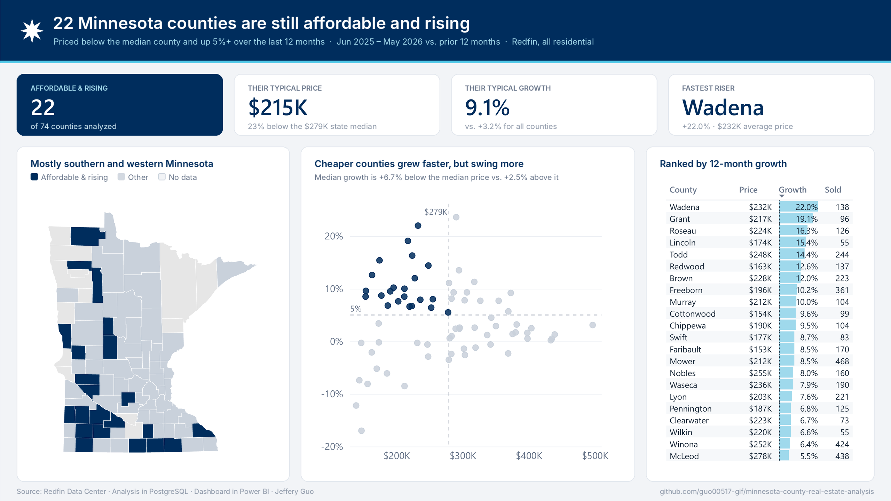

# Minnesota County Real Estate Analysis

Which Minnesota counties are still affordable but rising in price? This project uses Redfin's county housing data and PostgreSQL to compare every county's home prices over the last 12 months against the 12 months before, then flags counties that are cheaper than the typical Minnesota county and growing more than 5% a year. I call these **Affordable & Rising** counties.

**Result:** 22 of 74 counties are Affordable & Rising (data through May 2026). Full list: [`data/county_affordable_rising.csv`](data/county_affordable_rising.csv).

*Built in Power BI. [Dark version](dashboard/mn_affordable_rising_dark.png)*

## Key findings

- **22 of 74 counties** are priced below the Minnesota county median ($279K) and grew more than 5% over the last 12 months.
- Their typical price is **$215K**, about 23% below the state median, and their typical growth is **+9.1%**, vs. +3.2% for all counties.
- **None are in the Twin Cities metro.** Most are in southern and western Minnesota.
- **Wadena County** grew the fastest of the 22 (+22.0%). Pope County grew even faster (+23.6%) but isn't included because its price is above the median.
- **Cheaper counties grew faster but swing more.** Counties below the median price had median growth of +6.7%, vs. +2.5% above it, but they also had the biggest drops. Smaller markets are noisier, which is why the analysis requires 50+ sales per year.

## Data

- **Source:** [Redfin Data Center](https://www.redfin.com/news/data-center/), Housing Market Tracker, county level, monthly.
- The full US file is about 1.35 million rows (711 MB), which is too large for GitHub. Download it from the link above and load it with `sql/01_load_data.sql`.
- After filtering to Minnesota: 39,296 rows, 80 counties, January 2012 to May 2026.
- Each row is one county, one month and one property type (All Residential, Single Family, Townhouse, Condo/Co-op, Multi-Family).

## How it works

| File | What it does |
|---|---|
| `sql/01_load_data.sql` | Loads the raw Redfin file as text, then builds a clean Minnesota table with real dates and numbers. Redfin writes missing values as `NA`, so those are converted to NULL. |
| `sql/02_county_yoy_12m.sql` | View that compares each county's last 12 months (Jun 2025 to May 2026) with the prior 12 months. Uses All Residential only and requires 50+ sales in both periods. |
| `sql/03_affordable_rising.sql` | Flags counties priced below the Minnesota county median that are growing more than 5% year over year. |

**12-month price:** Redfin only publishes a median sale price per month, so the yearly price is a sales-weighted average of the monthly medians. It is an approximation of a true yearly median, not the exact value.

## What I fixed (October 2026)

The first version of this project gave misleading results. When I went back through it, I found three problems:

1. **Mixed property types.** The year-over-year comparison matched counties without matching property type, so a county's condo price could be compared against its single-family price from the year before. Some counties showed up four times with fake growth numbers (one at +491.7%). **Fix:** filter to `All Residential` only.
2. **Tiny samples.** A county with 1 sale one month and 2 the next can swing hundreds of percent. **Fix:** compare full 12-month periods instead of single months, and require at least 50 sales per year in both periods. This leaves 74 of the 80 counties.
3. **Incomplete data.** The original download was missing rows, including Hennepin County's most recent month. **Fix:** re-downloaded the complete Redfin file and checked that every month has 76 to 80 Minnesota counties.

| Version | Counties flagged |
|---|---|
| Original (mixed property types, single month) | 16 |
| Property-type fix, single month | 6 |
| Final (12-month comparison, complete data, 50+ sales) | 22 |

## Dashboard

Built in Power BI Desktop from the two CSVs in `data/`.

| File | What it is |
|---|---|
| `dashboard/mn_affordable_rising.pbix` | Light version |
| `dashboard/mn_affordable_rising_dark.pbix` | Dark version |
| `dashboard/assets/` | Custom theme (Minnesota state flag colors), page background and a Minnesota county TopoJSON map for the Shape map visual |

DAX measures calculate the card values: the count, median price and median growth of the 22 counties, and the fastest-growing one. The scatter plot's dashed lines are the same cutoffs the SQL uses: the median county price and 5% growth.

## Limitations and next steps

- 7 of Minnesota's 87 counties aren't in Redfin's data at all, including St. Louis (Duluth), Clay (Moorhead) and Blue Earth (Mankato). Another 6 were dropped for having fewer than 50 sales a year.
- 22 of 74 counties (about 30%) pass the test, so "more than 5% growth" may be too easy a bar. A better version would compare each county's growth against statewide growth.
- Monthly medians averaged together are an approximation of the true yearly median.
- Price growth alone doesn't account for rents, taxes or inventory. Adding months of supply and days on market would make the signal stronger.

## Tools

PostgreSQL 18, pgAdmin 4, Power BI Desktop (dashboard)